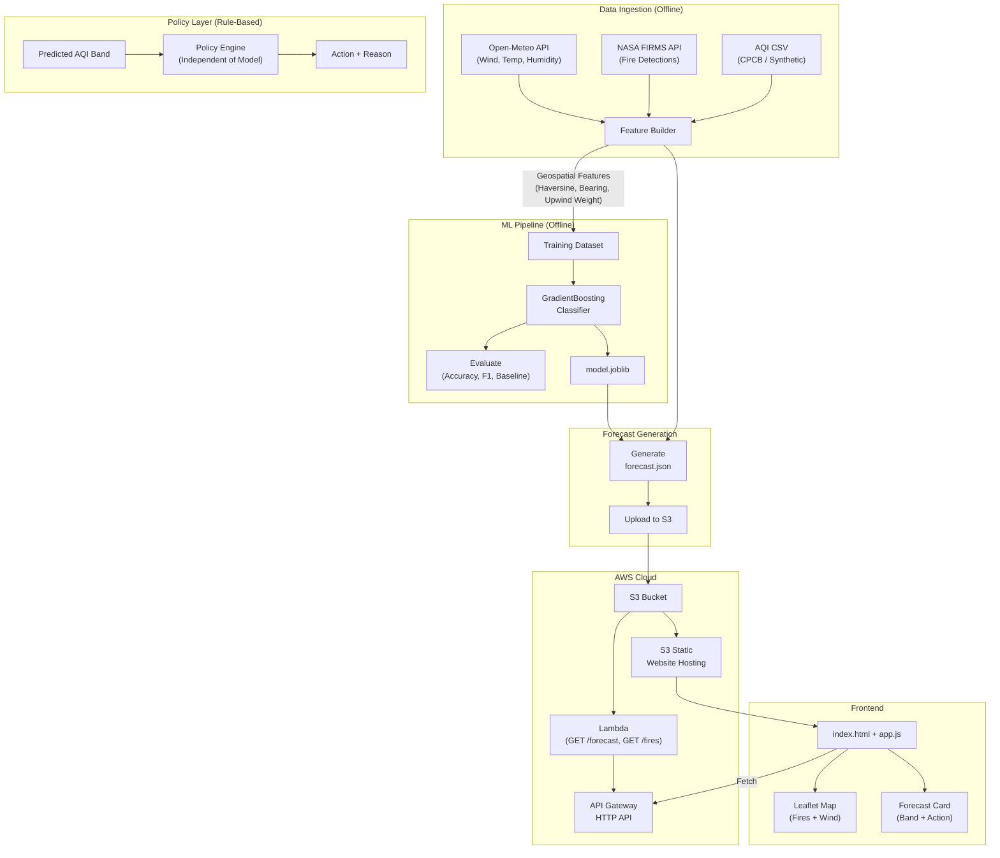

# Stubble Smoke Alert

**Next-day AQI early-warning for Delhi-NCR schools.**

Every autumn, stubble burning in Punjab and Haryana pushes Delhi's AQI into hazardous ranges. Schools get little advance notice. This tool predicts tomorrow's AQI band from upwind satellite fire detections and weather data, then converts the forecast into a clear, bounded action for school administrators.

Built for the **Air Track** of the **Environmental Hacks** hackathon (AWS Bharat Builds Tour).

---

## Architecture



## Quick Start

### Prerequisites

- Python 3.11+
- AWS CLI configured (`aws configure`)
- AWS SAM CLI (for deployment)

### 1. Install dependencies

```bash
pip install -r requirements.txt
```

### 2. Configure environment

```bash
cp .env.example .env
# Edit .env to add your FIRMS_MAP_KEY (optional)
```

### 3. Run the pipeline

```bash
# Download weather data
python data/download_weather.py

# Download fire data (requires FIRMS_MAP_KEY in .env)
python data/download_fires.py

# Generate synthetic AQI data (or place real data at data/raw/delhi_aqi.csv)
python data/generate_synthetic_aqi.py

# Build features
python -c "from src.features import build_features; from src.config import RAW_DIR, PROCESSED_DIR; build_features(RAW_DIR, PROCESSED_DIR)"

# Train model
python -c "from src.train import train_model; train_model()"

# Evaluate model
python -c "from src.evaluate import evaluate_model; evaluate_model()"

# Generate forecast
python -m src.forecast
```

### 4. Run tests

```bash
python -m pytest tests/ -v
```

### 5. View frontend locally

```bash
# Copy forecast for local dev
copy data\processed\forecast.json frontend\forecast.json

# Start dev server
python -m http.server 8080 --directory frontend
# Open http://localhost:8080
```

### 6. Deploy to AWS

```bash
# Build and deploy SAM
sam build
sam deploy --guided

# After deployment, note the API URL and bucket name from outputs, then:
python deploy.py --bucket YOUR_BUCKET_NAME --api-url YOUR_API_URL
```

---

## Evaluation Results

**Model**: GradientBoostingClassifier (200 estimators, max_depth=4)
**Split**: Chronological 80/20 (train up to Jul 2024, test Jul-Dec 2024)
**Data**: Synthetic AQI + Open-Meteo weather (no fire data in this run)

| Metric | Model | Baseline (tomorrow = today) | Lift |
|--------|-------|-----------------------------|------|
| Accuracy | 69.7% | 79.4% | -9.7% |
| Macro F1 | 67.2% | 80.4% | -13.2% |

**Honest assessment**: The naive "tomorrow equals today" baseline beats the model on overall accuracy. This is expected because AQI has high day-to-day autocorrelation. However:

- The model achieves **96% recall on "Very Poor"** days, which matter most for student safety
- The **policy layer adds value regardless** by converting any prediction into a bounded, actionable instruction
- Real fire data (with a FIRMS MAP_KEY) would likely improve performance, especially during stubble season transitions

### Per-class Performance

| Band | Precision | Recall | F1 | Support |
|------|-----------|--------|----|---------|
| Good | 0.65 | 0.37 | 0.47 | 41 |
| Moderate | 0.52 | 0.77 | 0.62 | 39 |
| Poor | 0.83 | 0.75 | 0.79 | 20 |
| Very Poor | 0.82 | 0.96 | 0.88 | 51 |
| Severe | 1.00 | 0.43 | 0.60 | 14 |

### Top Features

1. `aqi_today` (37%) - Today's AQI (strong autocorrelation)
2. `day_of_year` (18%) - Seasonality
3. `temp_max` (9%) - Temperature
4. `aqi_3day_avg` (8%) - 3-day trend
5. `wind_speed_max` (5%) - Wind speed

---

## Policy Layer

The policy layer is **independent of the ML model** and fully unit-tested.

| AQI Band | AQI Range | School Action |
|----------|-----------|---------------|
| Good | 0-50 | Normal outdoor activity |
| Moderate | 51-100 | Normal activity; monitor sensitive students |
| Poor | 101-200 | Shorten outdoor activity to 30 min; masks for sensitive students |
| Very Poor | 201-300 | Move PE and assembly indoors; close windows |
| Severe | 301-500 | Cancel outdoor activities; notify parents |

Each forecast includes a plain-language **reason** (e.g., "Northwesterly winds at 18 km/h; 142 upwind fire detections carrying smoke toward Delhi").

---

## AWS Usage

| Service | Purpose |
|---------|---------|
| **S3** | Stores forecast.json, fire data, model artifacts, and hosts the static frontend |
| **Lambda** | Serves GET /forecast and GET /fires endpoints (reads from S3, no ML deps) |
| **API Gateway** | HTTP API with CORS, routes to Lambda |
| **SAM** | Infrastructure-as-code deployment (template.yaml) |

### Why AWS?

- **S3**: Cost-effective storage for both data and static hosting. The frontend is served directly from S3 with no web server needed.
- **Lambda**: Serverless, scales to zero when not in use. Perfect for a forecast API that gets periodic traffic.
- **API Gateway HTTP API**: Low-latency, auto-scaling API layer with built-in CORS.
- **SAM**: Reproducible deployment in a single `sam deploy` command.

---

## Limitations

1. **Synthetic AQI data**: The current build uses synthetic data calibrated to Delhi's seasonal patterns. Replace with real CPCB data for production use.
2. **No fire data in this build**: Without a FIRMS MAP_KEY, fire-based features are zero-filled. The model relies only on weather and autoregressive features.
3. **Model vs. baseline**: The naive baseline beats the model on accuracy due to AQI autocorrelation. The model's value is in detecting transitions between bands.
4. **Single-city**: Currently Delhi-only. Extending to other cities requires re-calibrating fire detection regions.
5. **Not a replacement for official CPCB bulletins**: This is an experimental early-warning tool.

---

## Data Sources & Licences

| Source | Licence | Key Required |
|--------|---------|:------------:|
| [Open-Meteo](https://open-meteo.com/) (ERA5 weather) | CC BY 4.0 | No |
| [NASA FIRMS](https://firms.modaps.eosdis.nasa.gov/) (VIIRS fires) | Open data | Yes (free) |
| CPCB Delhi AQI | Public government data | No |
| Synthetic AQI (fallback) | Generated for this project | N/A |

---

## Repository Structure

```
stubble-smoke-alert/
├── data/
│   ├── raw/                      # Downloaded data (gitignored)
│   ├── processed/                # Feature matrix + forecast.json
│   ├── download_weather.py       # Open-Meteo historical weather
│   ├── download_fires.py         # NASA FIRMS fire data
│   ├── generate_synthetic_aqi.py # Fallback AQI generator
│   └── SOURCES.md                # Data sources documentation
├── src/
│   ├── config.py                 # All tunable parameters
│   ├── geo.py                    # Haversine, bearing, upwind weight
│   ├── features.py               # Feature engineering pipeline
│   ├── train.py                  # Model training
│   ├── evaluate.py               # Evaluation + baseline comparison
│   ├── predict.py                # Prediction from features
│   ├── policy.py                 # Rule-based school actions
│   ├── forecast.py               # Forecast orchestrator
│   └── lambda_handler.py         # AWS Lambda API handler
├── tests/
│   ├── test_geo.py               # 19 tests
│   ├── test_features.py          # 16 tests
│   ├── test_policy.py            # 21 tests
│   └── test_api.py               # 8 tests
├── frontend/
│   ├── index.html                # Single-page app
│   ├── app.js                    # Fetch + render logic
│   └── style.css                 # Dark theme, responsive
├── model/                        # Trained model (gitignored)
├── template.yaml                 # AWS SAM template
├── deploy.py                     # Post-deploy upload script
├── requirements.txt
├── .env.example
└── README.md
```

**Total: 64 tests passing.**

---

## AI Tools Used

This project was built during the hackathon with AI assistance (Antigravity IDE / Claude). AI was used for:
- Code generation and iteration
- Data source research and API testing
- Test case generation
- Documentation drafting

All code was reviewed and understood. All architectural decisions, data schemas, and policy rules were human-directed.
